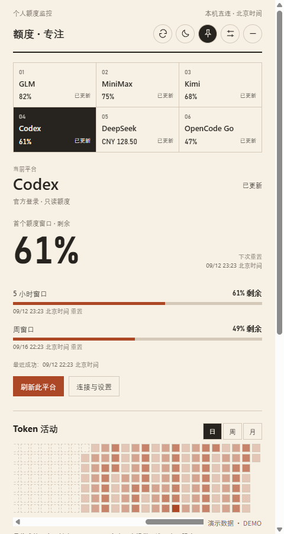
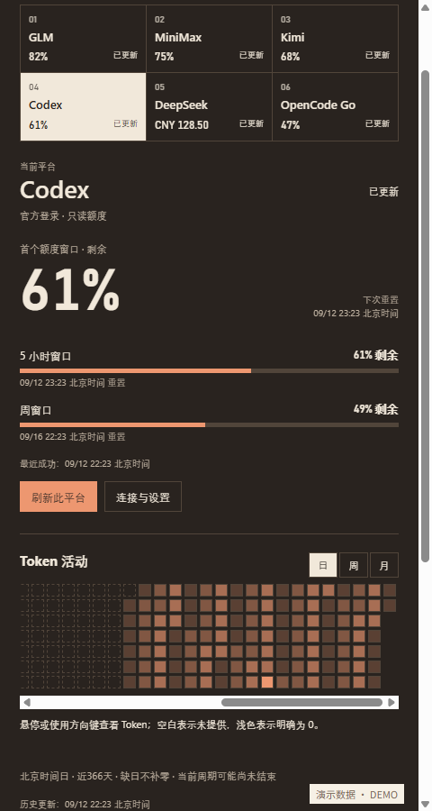
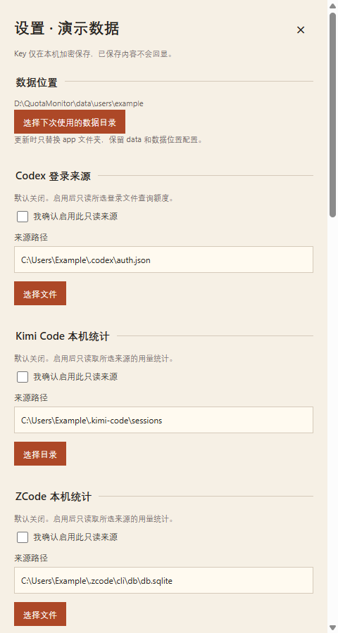

# Coding Quota Monitor · 多模型额度监控台

面向 **Windows 11 x64（Intel / AMD）** 的本地托盘工具，用一个面板查看多个平台额度与支持的用量统计。默认不读取本机登录或会话文件，选择来源并保存读取授权后才启用。

[下载 v1.3.0-beta.2](https://github.com/yusencai1996-gif/coding-quota-monitor/releases/download/v1.3.0-beta.2/QuotaMonitor-1.3.0-beta.2-windows-x64.zip) · [所有版本](https://github.com/yusencai1996-gif/coding-quota-monitor/releases) · [使用说明](PORTABLE-V1.3.md)

目前为测试版。Windows 10、ARM 以及每台电脑的自然重启与通知送达不在已验证范围内。

## 界面

以下均为程序实际渲染的**演示数据**截图，不是真实账号或真实用量；演示仅由独立截图脚本注入，正式程序没有模拟入口。





## 平台与范围

| 平台 | 支持范围 | 数据来源 |
| --- | --- | --- |
| GLM | 编程套餐额度、MCP 工具额度、支持的日活动与重置卡到期信息 | 国内站个人套餐 Key |
| MiniMax | 编程套餐额度；可选本机 Token 统计 | 国内站套餐 Key；本人选择的 ZCode 记录 |
| Kimi | 编程套餐额度、接口提供的月共享额度；可选本机 Token 统计 | 套餐 Key；本人选择的 Kimi Code / ZCode 记录 |
| Codex | 官方账号额度、附加模型额度、支持的活动与重置卡信息 | 本人明确启用的登录文件，只读现有访问令牌 |
| DeepSeek | API 余额、可选官方网页登录统计 | API Key；在本应用独立登录 |
| OpenCode Go | 套餐额度；浏览器授权适配中，工作区统计尚未完成 | 编程套餐 Key；默认浏览器 OAuth |

各平台独立查询，未配置或缺少本机客户端不会阻碍其它平台。接口没有提供的数据保持未知，不以零值、余额或倒计时推算用量。重置卡只查看，不自动使用。

## 首次使用

1. 完整解压 ZIP 到可写目录，普通双击 `app/多模型额度监控台.exe`，不要以管理员身份运行；高权限启动可能影响 Windows 通知。
2. 第一次打开设置，确认数据位置。分别输入自己需要的平台 Key，保存后在本机加密，不回显旧值。
3. Codex、Kimi Code、ZCode 来源默认关闭。选择路径、勾选确认，再点击“保存来源与读取授权”；只选路径或只勾选但未保存不会启用。
4. DeepSeek 网页统计在本应用独立窗口登录。OpenCode 修复分支改为默认浏览器授权；授权成功后仍需验证官方统计工具，当前不宣称已同步用量。**不需要上传或复制任何已有数据目录、Cookie 或登录文件。**

OpenCode 候选实现使用官方 Console OAuth（PKCE）和本机临时回调，授权只由点击连接发起；启动、刷新不会主动弹出浏览器。授权记录通过 Windows 加密存储保存在当前用户数据目录的 `opencode-oauth.sealed`；“取消授权 / 断开连接”清除本应用授权并尽力通知官方撤销，不退出默认浏览器账号。真实授权和统计适配验收完成前，此修复分支不应作为正式修复合并或替换日常安装。
5. 自启与通知默认关闭，按需启用。关闭主窗口会收起到托盘，从托盘菜单“退出”才会正常结束。

## 权限与数据

- Key 使用当前 Windows 用户和当前配置的加密上下文保存。换机器应重新填写与登录，不复制加密数据。
- Codex 仅读取本人指定文件，不刷新令牌、不写回文件。默认路径建议来自 `CODEX_HOME` 或当前用户 `.codex`，生成建议不读取内容。
- 本机统计只提取支持的数值字段；撤回或切换来源后取消旧查询并清除旧来源当前展示。
- 自启仅管理当前用户、当前数据配置且归属可验证的任务。不会接管同名第三方程序。
- 日志只记录有限的启动阶段等安全信息。提交 issue 时不要上传 `data/`、Key、登录文件、Cookie 或带个人内容的截图。

## 更新与移动

正常退出后只替换 `app/`，保留 `data/`、`quota-monitor.json` 和个人 `quota-location-*.json`。设置可选择下次使用的独立数据根：先关闭自启，再选择并确认；旧数据保留，不自动搬迁。移动整个目录前关闭自启，移动后按需重新开启。

## 从源码运行

需要 Windows 11 x64、**Node.js 26.2.0（本次验证版本）或更新版本**、npm，以及系统自带 Windows PowerShell。普通用户下载 ZIP 无需 Node 或 Python；从源码打包也无需 Python。先 clone 本仓库，然后在仓库目录运行：

```powershell
git clone https://github.com/yusencai1996-gif/coding-quota-monitor.git
cd coding-quota-monitor
npm ci
npm run setup:electron
npm run typecheck
npm test
npm run build
npm start
```

Electron 44 需要单独安装运行时；`setup:electron` 会下载匹配的官方二进制文件，`start` 和 `pack` 也会自动检查。下载受网络限制时可按 Electron 官方说明配置下载镜像。

构建完整应用和可下载 ZIP：

```powershell
npm run pack
npm run package
```

ZIP 与 `SHA256.json` 位于 `release/v1.3.0-beta.2/`。测试只用合成资料，默认临时目录来自 `os.tmpdir()`；也可把 `QUOTA_TEST_TEMP` 设置为自己选择的绝对目录。测试不读取实际 Key、登录或系统自启配置。生成演示截图需先完成 `npm run pack`，再运行 `npm run screenshots`；它使用独立数据根，不修改正式程序入口。

## 局限

官方接口或页面更新可能影响解析。统计覆盖范围与账号权限、所选客户端记录有关，不代表所有设备的全量用量。轮询间已经发生又被重置的低额度无法保证捕获。通知 `show` 回调不保证用户看见横幅，仍受 Windows 通知中心、勿扰和权限影响。开发构建默认没有代码签名。

## 许可

[MIT](LICENSE)，第三方组件见 [许可说明](THIRD-PARTY-NOTICES.md)。
